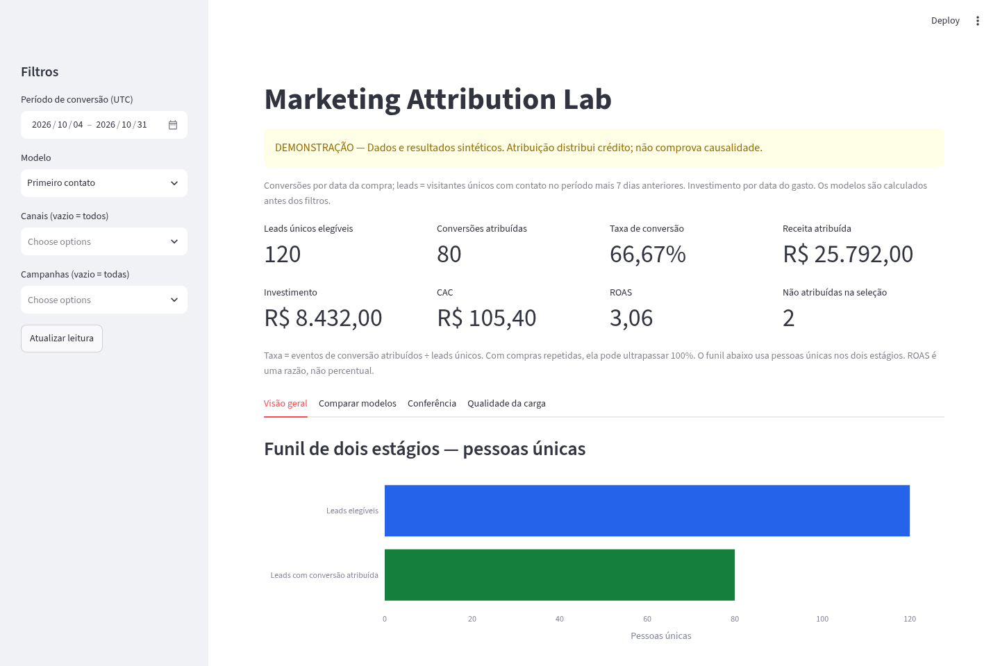

# marketing-attribution-lab
ETL with DuckDB and a Streamlit dashboard comparing first-touch and last-touch attribution using synthetic data.

> **DEMONSTRAÇÃO:** todos os dados e resultados são sintéticos.

## Objetivo de negócio
Apoiar Marketing/Growth na comparação de como canais e campanhas recebem crédito por leads, conversões e receita. A pergunta é: **como o desempenho muda entre primeiro e último contato antes da compra?**

## Arquitetura
```text
CSV sintético em data/raw/
    -> src/etl.py: validação, normalização, deduplicação
    -> DuckDB: stg_* -> mart_conversion_attribution -> mart_campaign_attribution
    -> src/analytics.py: filtros, denominadores e indicadores compartilhados
    -> app.py: dashboard Streamlit + gráficos Plotly + conferência + qualidade
```
Sem API, serviço de banco, autenticação, dados pessoais reais ou integrações com plataformas de anúncios.

## Instalação e execução — Windows / PowerShell
Python 3.11 ou superior. Testado com Python 3.13 e as versões de `requirements.txt`.

Na raiz do repositório:
```powershell
py -3 -m venv .venv
.\.venv\Scripts\python.exe -m pip install -r requirements.txt
.\.venv\Scripts\python.exe -m src.sample_data
.\.venv\Scripts\python.exe -m src.etl
.\.venv\Scripts\python.exe -m pytest -q
.\.venv\Scripts\python.exe -m streamlit run app.py
```
Não é preciso ativar o ambiente nem alterar a política de execução do PowerShell.
O Streamlit informa no terminal a URL local, normalmente `http://localhost:8501`.

Linux/macOS: crie o ambiente com `python3 -m venv .venv` e use `.venv/bin/python` nos comandos acima.

### Usar a amostra versionada sem regenerá-la
```powershell
New-Item -ItemType Directory -Force data\raw | Out-Null
Copy-Item data\sample\*.csv data\raw\
.\.venv\Scripts\python.exe -m src.etl
```
O gerador usa semente fixa 42 e datas fixas. Ele sobrescreve **somente os três CSVs de entrada** no diretório escolhido; use apenas em uma pasta de demonstração. Os CSVs em `data/sample/` contêm os mesmos dados reproduzíveis.

### Recarregar dados
Encerre o Streamlit com Ctrl+C, execute o ETL e inicie o dashboard novamente. Isso evita conflitos de acesso ao arquivo DuckDB, sobretudo no Windows. A carga monta uma base temporária, fecha a conexão e substitui a base anterior somente após sucesso. Erros de arquivo, esquema ou conflito de canal não apagam a base anterior. O banco gerado fica em `data/processed/attribution.duckdb` e não é versionado.

## Contratos dos três CSVs
UTF-8, separador vírgula, cabeçalho obrigatório e ponto como separador decimal. Valores monetários simulados em BRL; negativos e não finitos são rejeitados. Datas/horários são normalizados para UTC; horários sem offset são interpretados como UTC.

### touchpoints.csv
| Campo | Definição |
|---|---|
| `touchpoint_id` | Identificador único do contato; usado no desempate |
| `visitor_id` | Identificador sintético da pessoa/visitante |
| `touchpoint_at` | Data/hora do contato, preferencialmente ISO 8601 com offset |
| `channel` | Canal; espaços e caixa são normalizados |
| `campaign` | Campanha; identificador consistente entre fontes |
| `utm_source`, `utm_medium`, `utm_campaign` | UTMs da demonstração; podem estar vazias |

Canal vazio vira `desconhecido`; campanha vazia vira `sem_campanha`, com aviso no relatório de qualidade. Uma campanha só pode pertencer a um canal entre as fontes; conflito aborta a carga. O valor `__unattributed__` é reservado e não pode ser informado como campanha/canal.

### conversions.csv
| Campo | Definição |
|---|---|
| `conversion_id` | Identificador único da conversão/compra |
| `visitor_id` | Chave de ligação com os contatos |
| `converted_at` | Data/hora da conversão |
| `revenue` | Receita simulada não negativa, arredondada a centavos |

Um visitante pode ter mais de uma compra. Conversões sem contato elegível não são rejeitadas: são classificadas como não atribuídas.

### campaign_spend.csv
| Campo | Definição |
|---|---|
| `spend_date` | Dia UTC do gasto, em `YYYY-MM-DD` |
| `campaign` | Campanha; obrigatório |
| `channel` | Canal; necessário para filtrar investimento mesmo sem contatos |
| `spend` | Investimento simulado não negativo; zero explícito é permitido |

Uma linha por data/campanha. Duplicatas conservam a primeira linha válida, sem somar duas vezes o mesmo investimento.

## Regras de atribuição
1. Cada conversão considera contatos do mesmo visitante no intervalo **[conversão − 7 dias, conversão)**. Exatamente 7 dias antes é elegível; no instante da compra ou depois, não.
2. `first_touch`: contato elegível mais antigo. `last_touch`: mais recente.
3. Empate no horário: menor `touchpoint_id` em ordem lexicográfica, nos dois modelos.
4. Cada conversão possui exatamente uma linha por modelo na tabela de detalhe. Sem contato elegível, `touchpoint_id` fica nulo e canal/campanha recebem `__unattributed__`.
5. A jornada é atribuída **antes** dos filtros do painel. Filtrar uma campanha não recalcula a jornada para fazer essa campanha receber crédito.
6. Os modelos nunca alteram o investimento da campanha.

## Período, leads e denominadores — convenções explícitas do MVP
- **Coorte de conversões:** compras cuja data UTC está entre o início e o fim selecionados, inclusive.
- **Leads únicos elegíveis:** visitantes com contato válido entre **início − 7 dias** e o fim selecionado, aplicando canal/campanha ao contato. É uma proxy de lead: não existe evento separado de cadastro no escopo. O período ampliado inclui contatos anteriores que podem receber crédito por compras da coorte.
- **Investimento:** gastos com data dentro do período selecionado, filtrados separadamente por campanha/canal. Não é multiplicado pelo número de contatos, conversões ou modelos.
- Canal/campanha filtram o contato escolhido de cada conversão, os contatos do denominador e os gastos. Sem seleção, consideram-se todos; com seleção, a categoria não atribuída fica fora da seleção de campanhas/canais.
- O total de leads é calculado por visitante distinto, não pela soma dos leads das campanhas: uma pessoa pode ter passado por mais de uma.
- Essas convenções comparam receita de uma coorte com gastos por data; não representam estudo causal nem análise de custos de aquisição por coorte completa.

## Indicadores
| Indicador | Fórmula/definição |
|---|---|
| Leads únicos | Visitantes distintos no universo de contatos elegíveis definido acima |
| Conversões atribuídas | Eventos de compra com contato elegível na seleção |
| Não atribuídas | Eventos sem contato elegível; não entram na receita atribuída |
| Taxa de conversão | Conversões atribuídas / leads únicos elegíveis |
| Receita atribuída | Soma da receita das conversões atribuídas na seleção |
| Investimento | Soma dos gastos, sem repetição entre modelos |
| CAC | Investimento / conversões atribuídas |
| ROAS | Receita atribuída / investimento |

- O nome CAC segue o requisito; neste MVP é custo por **evento de conversão**, não necessariamente custo por cliente novo.
- A taxa prescrita pode superar 100% com compras repetidas. Por isso o funil usa **pessoas únicas nos dois estágios**: leads elegíveis e leads com compra atribuída. Ele não inventa uma etapa de cadastro ausente nos dados.
- Denominador zero gera `N/A`. Investimento desconhecido gera `N/A` em investimento total, CAC e ROAS. Se parte dos custos estiver ausente, o painel exibe as campanhas sem cobertura e a soma conhecida, mas não calcula ratios com custo incompleto.
- Gasto explicitamente zero é diferente de gasto desconhecido: CAC pode ser 0 com conversões e custo 0; ROAS fica N/A com divisor 0. Receita 0 com gasto positivo produz ROAS 0.
- Ausência de uma linha diária não é inferida como falha de dados: só é possível detectar campanhas sem **nenhum** gasto no período. Validar completude diária exigiria um calendário/plano de mídia fora deste escopo.
- Na tabela técnica do painel, campos monetários/rates nulos significam N/A; `revenue`, `investment`, `conversion_rate`, `cac`, `roas` correspondem aos indicadores acima. Não some taxas nem contagens distintas.

## Tabelas DuckDB
| Tabela | Granularidade |
|---|---|
| `stg_touchpoints` | Um contato válido por `touchpoint_id` |
| `stg_conversions` | Uma compra válida por `conversion_id` |
| `stg_campaign_spend` | Um investimento por data/campanha |
| `mart_conversion_attribution` | Uma conversão por modelo; inclui não atribuídas |
| `mart_campaign_attribution` | Data da conversão, modelo, campanha e canal |
| `etl_run` | Metadados da última carga |
| `etl_summary` | Contagens de entrada/aceitos/rejeitados/duplicados por arquivo |
| `etl_issues` | Linha CSV, classificação, motivo e registro original sintético |

O mart agregado é persistido para inspeção SQL. O painel usa o detalhe para recalcular visitantes distintos corretamente em qualquer período — não soma contagens distintas diárias.

## Qualidade e conferência
- IDs em branco, datas inválidas e valores monetários inválidos são rejeitados por linha.
- Duplicatas mantêm o primeiro registro **válido**, seguindo a ordem do arquivo.
- `input_rows = accepted_rows + rejected_rows + duplicate_rows`; avisos são subconjunto dos aceitos.
- Arquivos ausentes, esquema incompatível ou campanhas com canais conflitantes interrompem a carga antes da substituição da base.
- A amostra inclui intencionalmente uma duplicata e uma data inválida nos contatos, uma duplicata nas compras e um gasto negativo para demonstrar as ocorrências. Também inclui compras não atribuídas.
- A aba Conferência apresenta atribuição por compra, contatos usados no denominador, gastos filtrados e fontes aceitas completas. Permite baixar atribuição e ocorrências em CSV.

## Testes e rastreabilidade
```powershell
.\.venv\Scripts\python.exe -m pytest -q
```
A suíte cobre janela e limites, desempates, conversões não atribuídas, deduplicação, inválidos, custo ausente/zero/parcial, compras repetidas, filtros sem reatribuição, totais conciliados, preservação de base anterior, reprodutibilidade e execução do Streamlit.

| Requisito | Implementação |
|---|---|
| RN-01 | ETL dos três CSVs, estágios, `etl_summary` e `etl_issues` |
| RN-02 | SQL de atribuição e comparação de modelos |
| RN-03 | `src/analytics.py` e filtros/indicadores em `app.py` |
| RN-04 | README, aba Conferência e download de dados |
| RN-05 | Rejeições/avisos, não atribuídas, custos ausentes e N/A |
| RN-06 | Avisos permanentes no README/painel e dados exclusivamente sintéticos |

## Captura do dashboard


## Estrutura
```text
app.py
requirements.txt
src/
    __init__.py
    etl.py
    analytics.py
    sample_data.py
tests/test_project.py
data/sample/                  # CSVs sintéticos versionados
data/raw/                     # CSVs locais, gerados/copiados; não versionados
data/processed/               # DuckDB local; não versionado
docs/dashboard.png
```

## Fora do escopo
Dados reais, APIs, edição de registros pelo painel, aplicação multiusuário transacional, ML, deploy/hospedagem, credenciais e prova causal de desempenho. Não usar este MVP como recomendação real de investimento.

## Licença
MIT — mantida do repositório original. Os dados sintéticos são gerados pelo próprio projeto, sem bases de terceiros.
